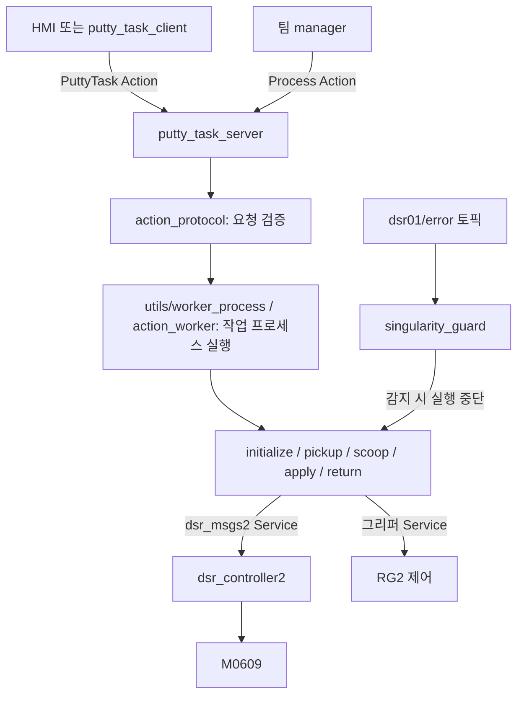

# 퍼티 데모 이해하기: 요청부터 도포·정지까지

이 문서는 퍼티 코드를 처음 읽는 팀원을 위한 안내서입니다.
먼저 전체 흐름을 읽고, 관심 있는 동작의 파일로 이동하면 됩니다.
기존 [ACTIONS.md](ACTIONS.md)는 실행·인터페이스 중심의 안내서로 그대로 보존합니다.

2026-11-18 현재 소스를 기준으로 작성했습니다. ByteDance의
[code-documentation 스킬](https://github.com/bytedance/deer-flow/blob/main/skills/public/code-documentation/SKILL.md)의
코드 분석 → 역할·흐름 설명 → 경로·인터페이스 검증 방식을 적용했습니다.
스킬 지침을 읽어 적용했으며 별도 스킬 패키지를 설치한 것은 아닙니다.

## 1. 먼저 알아야 할 네 가지

1. **작업 요청은 Action**, 실제 두산 로봇에 보내는 이동·힘 설정은 **Service**입니다.
2. Python 파일 하나가 모두 ROS 노드인 것은 아닙니다. 경로 계산·접촉 판정 파일은 보조 모듈입니다.
3. 서버를 켜는 것과 작업을 요청하는 것은 다릅니다. 작업 Goal을 보내야 실행합니다.
4. 구현된 경로와 실제 검증 완료 여부는 다릅니다. 현재 힘 형성과 특이점 문제는 미해결 항목입니다.

환경은 ROS 2 Jazzy, M0609 + RG2, 네임스페이스 `dsr01`, TCP `GripperDA_v1`입니다.
소스 폴더는 `src/rokey1_ws`지만 ROS 패키지 이름은 **`rokey1`**입니다.
따라서 실행 명령도 `ros2 run rokey1 ...`을 사용합니다.

## 2. 전체 공정과 현재 지원 범위

목표 공정은 다음 순서입니다.

```text
초기화 → 헤라 집기 → 퍼티 뜨기 → 벽에 도포 → 헤라 반납 → 초기화(홈 복귀)
```

| 작업명 | 실행 파일 | 하는 일 | 현재 구분 |
|---|---|---|---|
| `initialize` | [initialize_device.py](initialize_device.py) | 홈 관절 자세 이동과 그리퍼 초기화 | 실물/가상 연결 지원 |
| `pickup` | [pickup_spatula.py](pickup_spatula.py) | 홈 위 상승, 집기 위치 접근, 파지와 상승 | 실물/가상 연결 지원 |
| `scoop` | [scoop_putty.py](scoop_putty.py) | 측정 자세 기반 사선 진입과 퍼티 뜨기 | 실물 액션은 사용자 파지 확인 필요 |
| `apply` | [apply_putty_plane.py](apply_putty_plane.py) | 면 접근, 접촉 탐색, 힘 검증, 각도 변화 도포 | 실물 연결 지원, 미해결 설정 충돌 있음 |
| `return` | [return_spatula.py](return_spatula.py) | 헤라 반납 경로와 그리퍼 열기 | 현재 가상 전용 |

`putty_cycle.launch.py`는 이 순서를 연결하지만 **기존 가상 geometry 스쿱/XY 도포 경로**입니다.
현재 실물 YZ 벽 작업을 처음부터 끝까지 자동 연결한 런치로 해석하면 안 됩니다.
“원하는 전체 공정”과 “현재 가상 전체 공정 런치”를 구분해서 봅니다.

## 3. 요청이 로봇까지 전달되는 구조



예를 들어 사용자가 `apply`를 요청하면 서버는 입력값을 검증하고,
자식 프로세스에서 `apply_putty_plane.main()`을 실행합니다.
도포 파일은 경로를 계산하고, `putty_motion`이 드라이버 서비스를 호출합니다.
서버는 작업 로그와 위치·힘 조회값을 클라이언트에 전달합니다.

작업을 별도 프로세스에서 실행하는 이유는 기존 작업의 ROS 응답 대기와
액션 서버의 취소 처리를 분리하기 위해서입니다. 이동 서비스가 끝나기를 기다리는 중에도
서버가 취소를 받아 별도로 정지 요청을 보낼 수 있습니다.

## 4. 파일을 어떤 순서로 읽으면 좋을까?

| 읽는 순서 | 파일 | 확인할 내용 |
|---|---|---|
| 1 | [putty_task_client.py](putty_task_client.py) | 작업명·옵션으로 Goal을 만들고 결과를 기다리는 부분 |
| 2 | [putty_task_server.py](putty_task_server.py) | Goal 접수, 동시 실행 차단, 피드백, 취소·정리 |
| 3 | [action_protocol.py](action_protocol.py) | 허용 옵션, 모드와 입력 검증, 공통 Process 변환 |
| 4 | [action_worker.py](action_worker.py) / [utils/worker_process.py](../utils/worker_process.py) | 작업 파일 선택, 로그 수집, 프로세스 중단 |
| 5 | [apply_putty_plane.py](apply_putty_plane.py) | 도포 설정, 접촉점·각도에서 TCP 경로 계산 |
| 6 | [putty_motion.py](putty_motion.py) | ROS 이동 요청, 응답·도착 검사, 힘 유지와 로그 |
| 7 | [contact_search.py](contact_search.py) | 접촉 감지, 순응제어 시작/해제, 힘 안정 판정 |
| 8 | [putty_geometry.py](putty_geometry.py) | 회전·좌표 계산 공통 함수 |
| 9 | [singularity_guard.py](singularity_guard.py) | 별도 감시 노드의 알람 구독과 중단 판정 |

`contact_search`, `putty_geometry`, `putty_motion`, `action_protocol`은 독립 실행 노드가 아닙니다.
다른 파일이 import하여 사용하는 Python 모듈입니다.
반면 `singularity_guard`는 도포 프로세스 안에서 별도 ROS 감시 노드와 스레드를 만듭니다.
“함수 호출”과 “노드 사이 ROS 통신”을 구분하면 파일이 많은 이유를 이해하기 쉽습니다.

## 5. 두 Action의 차이

| 항목 | 개별 작업용 PuttyTask | 팀 매니저용 Process |
|---|---|---|
| 이름 | `/dsr01/putty_task` | `/process/putty` |
| 타입 | `rokey_interfaces/action/PuttyTask` | `rokey_interfaces/action/Process` |
| 주 사용자 | CLI, HMI, 기존 공정 런치 | 팀 `manager` |
| 요청 내용 | 작업명, 가상 여부, 파지 확인, CLI 옵션 | `PUTTY`, run/gap ID, 시작·끝 XYZ |
| 실행 범위 | 초기화/집기/뜨기/도포/반납 중 하나 | 준비된 헤라로 세로 상향 도포 |
| 설정 | 작업 CLI 기본값과 전달 옵션 | [robot.yaml](../config/robot.yaml)의 `force.putty_scrape`를 옵션으로 변환 |
| 피드백 | 약 5 Hz의 단계·로그·위치·힘 | `putty_scrape` 완료 시 1회, DB 기록용 |

두 액션은 **같은 서버와 실행 잠금**을 사용합니다. 한쪽 작업 중 다른 작업이 들어오면 거절합니다.
Process는 집기·뜨기·반납을 자동으로 추가하지 않습니다.
시작점·끝점의 BASE X/Y가 같고 끝 Z가 더 커야 합니다.
Process 결과의 `wall`/`gaps`는 탐사용 필드이며 퍼티가 탐지 결과를 생성하는 것은 아닙니다.

PuttyTask Goal의 `tool_held_confirmed=true`는 사용자의 파지 확인입니다.
그리퍼 센서로 헤라가 잡혔음을 자동 판정했다는 뜻은 아닙니다.

## 6. Service와 Topic은 어디에 쓰일까?

아래 드라이버 서비스 경로 앞에는 `/dsr01/dsr_controller2`가 붙습니다.

| 용도 | 경로와 타입 |
|---|---|
| 실물/가상 확인 | `/system/get_robot_system` — `dsr_msgs2/srv/GetRobotSystem` |
| 정지 상태 확인 | `/system/get_robot_state` — `dsr_msgs2/srv/GetRobotState` |
| TCP 위치·자세 조회 | `/aux_control/get_current_posx` — `dsr_msgs2/srv/GetCurrentPosx` |
| 관절값 조회 | `/aux_control/get_current_posj` — `dsr_msgs2/srv/GetCurrentPosj` |
| BASE 외력 조회 | `/aux_control/get_tool_force` — `dsr_msgs2/srv/GetToolForce`, `ref=0` |
| 직선 이동 | `/motion/move_line` — `dsr_msgs2/srv/MoveLine` |
| 관절 이동 | `/motion/move_joint` — `dsr_msgs2/srv/MoveJoint` |
| 연속 도포 경로 | `/motion/move_spline_task` — `dsr_msgs2/srv/MoveSplineTask` |
| 정지 | `/motion/move_stop` — `dsr_msgs2/srv/MoveStop` |
| 순응제어 시작 | `/force/task_compliance_ctrl` — `dsr_msgs2/srv/TaskComplianceCtrl` |
| 목표 힘 설정 | `/force/set_desired_force` — `dsr_msgs2/srv/SetDesiredForce` |
| 힘·순응제어 해제 | `/force/release_force`, `/force/release_compliance_ctrl` |

실물 RG2의 초기화·집기는 `/onrobot/sendCommand` 서비스를 사용합니다.
픽업의 가상 그리퍼 분기는 컨트롤 박스 디지털 출력 서비스를 사용합니다.

특이점 감시는 `/dsr01/error`의 `dsr_msgs2/msg/RobotError` **토픽 구독**입니다.
위치·힘 피드백은 현재 코드에서 드라이버 서비스를 조회해 만들며, 별도 센서 토픽을 구독하는 방식이 아닙니다.
ROS Action 자체도 내부적으로 Goal/Result/Cancel 서비스와 Feedback/Status 토픽을 사용합니다.
따라서 이 프로젝트에는 Action·Service·Topic이 모두 있습니다.

## 7. 벽 도포 한 번을 따라가기

다음은 `--contact-search`가 켜진 실물 벽 도포의 의도된 실행 순서입니다.
현재 설정 충돌이 있으면 액션 입력 검증에서 중단하므로 이 단계에 진입하지 않습니다.

```text
입력·컨트롤러·TCP 확인 + 특이점 정책 설정/감시 시작
  → 이송 높이 확보 → 면 밖 접근점으로 자세 정렬·이동 → 지정 시작점 접근
  → -Z로 바닥 찾기 → 정지 → +X로 벽 찾기 → 정지
  → 접촉한 실제 위치에 경로 맞추기
  → 순응제어 켜기 → BASE +X 목표 힘 요청
  → 실측 힘 안정 확인
  → 목표 힘 명령을 유지하며 각도 변화 상향 스플라인 이동
  → 힘·순응제어 해제 → 벽 바깥 -X로 후퇴
```

### 접촉 탐색과 힘 유지는 다르다

`seek_floor_then_wall()`은 유한 거리의 비동기 위치 이동 중 외력을 반복 조회합니다.
바닥은 -Z, 벽은 +X 방향으로 찾고, 탐색 시작 대비 해당 축 외력 변화가 기준에 도달하면 정지합니다.
현재 탐색 기본 한도는 방향마다 20 mm, 속도는 2 mm/s입니다.
접촉 후 +X로 7 mm/10 mm 같은 고정 추가 접근은 현재 없습니다.

그다음 `WallForceHold.start()`가 순응제어와 목표 힘을 설정합니다.
순응제어는 접촉력에 따라 위치를 유연하게 조절할 수 있게 하는 단계이고,
목표 힘 요청은 BASE X축에 힘 목표를 주는 단계입니다.
서비스의 `success=True`만으로 실제 벽에 목표 힘이 생겼다고 판정하지 않습니다.

`PressForceMonitor`는 실측 `|BASE Fx|`가 목표 ±허용오차에 들어오는지 확인합니다.
출발 전에는 같은 부호로 안정 시간과 최소 샘플 수를 충족해야 합니다.
도포 중 힘 상한 초과, 허용 시간 이상 힘 부족, 정상 범위에서 부호 반전이 생기면 중단합니다.
현재 감시는 힘 크기 기반이며 상대모드의 초기 힘 바이어스를 별도로 보정하지 않습니다.

힘 명령을 도포 중 매번 다시 보내는 구조는 아닙니다.
설정한 힘 명령을 해제하지 않은 상태로 스플라인 이동을 실행하고, 실측값을 반복 감시합니다.
힘 제어 중에는 X 위치를 고정 목표로 검사하지 않고 Y/Z와 자세 도착 및 X 편차를 확인합니다.

### 각도 변화와 TCP 보정

날 접촉점과 TCP는 서로 다른 점입니다.
`stroke_poses()`는 접촉점이 시작→끝 선을 따라가도록 계산하면서 각 지점의 자세를 바꿉니다.

```text
진행률 u = 0 ~ 1
날 각도 = 시작 각도 + (끝 각도 - 시작 각도) × u
날 접촉점 = 시작점 + (끝점 - 시작점) × u
TCP 위치 = 날 접촉점 - 현재 자세로 회전한 Tool 오프셋
```

현재는 선형 변화이며 기본값은 **20→10도**입니다. 예전에 논의한 45→30도와 다릅니다.
기본 날 오프셋은 Tool `[0, 0, 120]` mm이고, 현재 기본 접촉 경로는
BASE `[789.04, -15.52, 27.20]`에서 +Z로 180 mm입니다.
각도를 바꾸면 TCP의 X도 달라질 수 있습니다. TCP X 그래프만으로 날이 벽에서 떨어졌다고 단정할 수 없습니다.
장착 방향·길이 가정이 실제와 다르면 계산한 날 위치도 달라집니다.

도포 자세들을 `continuous_commands()`가 묶고 `MoveSplineTask` 한 번으로 보냅니다.
각 샘플마다 MoveLine을 보내 정지하는 방식은 아니지만, 접근·도포·후퇴 사이에는 단계 구분이 있습니다.

## 8. 현재 설정과 미해결 항목

| 항목 | 현재 값/동작 | 확인할 파일 |
|---|---|---|
| 유지 목표 힘 | 기본 6 N | `apply_putty_plane.py`, `robot.yaml` |
| 힘 요청 최소값 | 10 N 미만 거부 | `contact_search.press_force_request()` |
| 힘 모드 | 상대모드 `mod=1`, BASE `ref=0`, X축만 선택 | `press_force_request()` / YAML |
| 힘 검증 | 허용오차 ±1 N, 출발 안정 0.5 s, 이탈 0.5 s | `PressForceMonitor` |
| 힘 형성 대기 | 최대 30 s | `wait_for_press_force()` |
| 특이점 | YAML `avoid`, 힘 제어 특이점 ERROR 정책 + 알람 감시 | `putty_motion`, `singularity_guard` |

**6 N 기본값과 최소 10 N 검사는 충돌합니다.** PuttyTask 클라이언트/서버는 이동 전에 요청을 거부하며,
Process 경로는 설정 오류를 결과로 반환합니다. 이 문서 작성에서는 어느 값도 변경하지 않았습니다.
10 N으로 높이는 것을 해결책으로 제안하는 의미도 아닙니다. 목표값과 최소값의 의도를 먼저 정해야 합니다.
직접 작업 CLI를 호출하는 경로는 액션의 사전 검증 경로와 같지 않으므로 혼동하지 않습니다.

기본 CLI 값과 팀 YAML은 별도로 존재합니다. YAML을 수정했다고 모든 개별 CLI 기본값이 바뀌지는 않습니다.
YAML은 모듈을 읽을 때 로드되므로 수정 후 서버를 재시작해야 반영됩니다.
`ROKEY_CONFIG`가 있으면 해당 경로를 우선합니다.

특이점 알람 3205 진입 감시는 **진입 전 경로 전체를 예측하는 기능이 아닙니다**.
감지되면 정지·힘 해제를 수행하고 자동 MoveJ 회복/재시도는 하지 않습니다.
알람이 없다는 사실만으로 현재 자세가 안전하거나 힘 제어가 활성화됐다고 증명하지 않습니다.

## 9. 중간에 정지를 누르면?

전용 클라이언트의 Ctrl+C 또는 HMI 정지는 Action Cancel을 보냅니다.
서버는 다음 순서로 정리합니다.

1. 작업 프로세스를 일시 중지하여 다음 요청을 막습니다.
2. 별도 서비스로 MoveStop을 요청하고 STANDBY를 확인합니다.
3. 작업 프로세스 종료를 요청하고, 종료 후 로봇 정지를 다시 확인합니다.
4. 도포 작업이면 힘 제어와 순응제어 해제도 확인합니다.
5. 정리 성공 시 canceled, 정리 실패 시 aborted를 반환하고 새 작업을 차단합니다.

Cancel 접수와 실제 정지 확인은 다릅니다. `stop_confirmed`와 최종 결과를 함께 봅니다.
일반 `ros2 action send_goal`의 Ctrl+C만으로 로봇 정지를 가정하지 않습니다.
서버 강제 종료나 통신 장애까지 이 절차가 보장하는 것은 아닙니다.

## 10. 처음 확인할 명령과 로그

빌드·환경 로드 후 서버를 시작합니다. 서버 시작만으로는 움직이지 않습니다.

```bash
cd ~/ws_cobot_pjt/ws_dsr
source /opt/ros/jazzy/setup.bash
colcon build --packages-select rokey_interfaces rokey1 --symlink-install
source install/setup.bash
ros2 run rokey1 putty_task_server
```

별도 터미널에서 인터페이스를 조회할 수 있습니다. 아래 명령은 작업 Goal을 보내지 않습니다.

```bash
source ~/ws_cobot_pjt/ws_dsr/install/setup.bash
ros2 action list -t
ros2 action info /dsr01/putty_task
ros2 interface show rokey_interfaces/action/PuttyTask
ros2 interface show rokey_interfaces/action/Process
```

서버와 bringup은 같은 ROS domain이어야 합니다. `virtual_mode`는 로그 전용 드라이런이 아니라
가상 컨트롤러 선택이며, 연결된 컨트롤러 모드와 다르면 작업을 시작하지 않습니다.
현 상태의 도포 실행 예시는 위 힘 설정 충돌을 해결한 뒤 작성·검증해야 합니다.

| 로그/피드백 | 뜻 | 단정할 수 없는 것 |
|---|---|---|
| `힘설정응답확인=True` | 힘 설정 서비스가 성공 응답 | 실제 목표 힘 형성 여부 |
| `힘 형성 대기` | 실측 힘 출발 조건 미충족 | 목표 힘을 만들기 위한 이동이 충분한지 |
| `상향 도포 중·유지 확인` | 해당 측정 시점 힘 판정 정상 | 전체 구간 모든 순간의 접촉 보장 |
| `pose_valid/force_valid=False` | 최근 유효한 조회값 없음 | 위치/힘이 0이라는 의미 아님 |
| `계획날각` | 경로에서 추정한 계획 각도 | 독립 센서로 측정한 실제 날 각도 |
| `success=True` Result | 코드가 정의한 완료 조건 충족 | 도포 품질의 자동 판정 |

PuttyTask 위치·힘 피드백은 약 5 Hz지만 순차 서비스 조회값이므로 동시 측정이 아닙니다.
이동 서비스 대기로 조회가 지연되면 `조회 대기`가 나타날 수 있습니다.
Process의 힘 통계는 상승 중 출력된 Fx 로그 샘플 기준이며 고속 제어기 전체 데이터를 뜻하지 않습니다.
팀 manager가 DB 기록을 담당하고, 퍼티 서버가 직접 DB에 쓰지는 않습니다.

## 11. 검증 범위와 다음 수정 위치

문서 작성 전 통합 시점에는 두 패키지 빌드와 기능 테스트 154개가 통과했습니다.
이는 모의 테스트 결과이며 실물 도포 힘 형성·정지 거리·접촉 품질 검증 결과는 아닙니다.
이번 작업에서는 설명 문서만 추가했으며 로봇을 실행하지 않았습니다.

다음 수정 시에는 아래 파일에서 시작하면 됩니다.

- 날 위치·각도 경로: `apply_putty_plane.stroke_poses()`
- 실제 서비스 요청·도포 중 로그: `putty_motion.run_robot()`
- 힘 요청 모드·최소값·판정: `contact_search.py`
- 팀 Goal과 설정 변환: `action_protocol.process_putty_goal()`
- 작업 추가·취소·피드백: `putty_task_server.py`와 `action_worker.MODULES`
- 액션 메시지 정의: [PuttyTask.action](../../rokey_interfaces/action/PuttyTask.action), [Process.action](../../rokey_interfaces/action/Process.action)

숫자를 바꾸기 전에 실제 사용 경로가 개별 PuttyTask인지 팀 Process인지 확인합니다.
공유할 때는 메시지를 생성하는 `rokey_interfaces`도 함께 반영합니다.

## 12. 추가 작업: 판에서 퍼티 묻히기 (`load`)

기존 scoop와 별도인 [load_putty.py](load_putty.py)입니다.
확인된 판 접촉 TCP는 GripperDA_v1의 `[-431.88,-1.52,123.68,8.37,178.03,7.62]`이며
헤라를 잡고 날이 판에 닿았을 때의 값입니다. 헤라 길이 120/126 mm를 다시 보정하지 않습니다.
ABC 고정, -Z 탐색 → 정지 → 순응제어 + BASE -Z 절대 힘 → 실측 안정 확인 →
힘 명령 유지 중 +X 30~40 mm 위치 이동 → 힘 해제 → 상승 순서입니다.
실측 힘 상한·부족 지속·부호 반전·자세/이동 범위 오류는 정지 및 해제로 처리합니다.
긁기 자세는 측정값을 유지하며 날의 Y 평행 여부는 장착·측정 가정입니다.
퍼티 부착량이나 성공 품질을 센서로 판정하지 않습니다.

### 기둥과 시작 위치

자동 이송은 `--transfer-z <BASE TCP 높이> --transfer-speed <mm/s>`로 선택합니다.
현재 위치에서 MoveLine 수직 상승 → Ikin으로 판 위 TCP 목표를 관절로 변환 →
MoveJoint로 판 위 이송 → MoveLine으로 접촉 탐색 높이까지 하강합니다.
작업·수직 상승·힘 해제 후 이송 높이를 확보하고 MoveJoint로 출발 상승 자세 및
출발 관절 자세로 복귀합니다. 실패 시에는 자동 복귀하지 않고 정지·힘 해제합니다.
직선/관절 이동은 실제 도착을 확인합니다.
자동 이송 시 `--joint-speed <deg/s> --joint-acceleration <deg/s²>`가 추가로 필요합니다.
`--transfer-speed`는 수직 직선 이동 mm/s이므로 관절 속도로 재사용하지 않습니다.
현재 TCP가 이미 더 높으면 그 높이를 유지합니다. 지정 높이는 판 위 접근 높이보다 높아야 합니다.
이송 높이/속도 미지정 시 기존처럼 판 위 준비 위치에서만 시작합니다.
팀 요청은 `force.putty_load.transfer_z/transfer_speed`를 같은 방식으로 사용합니다.

이송 높이는 **TCP 높이**이므로 헤라 날이 더 낮다는 점을 고려해야 합니다.
이것은 기둥 충돌 회피나 역기구학 경로 검증을 자동 수행하는 기능이 아닙니다.
기둥 30×30 mm와 높이 약245 mm는 알려졌지만 꼭대기 측정점의 중앙 여부/기준 오프셋은
미확인입니다. 운영자가 헤라와 로봇 링크를 포함해 경로 및 높이를 검증해야 합니다.

### 개별 요청 (PuttyTask)

`putty_task_client load --tool-held-confirmed -- ...`로 기존 서버에 요청합니다.
접촉 힘/유지 힘/힘 상한과 허용오차·감시 시간·이동 설정은 명시적 필수 인자입니다.
운영 힘을 임의로 정하지 않았으므로 값 미입력 상태에서는 실행되지 않습니다.
옵션 목록은 아래 조회로 볼 수 있습니다. 도움말 조회는 이동하지 않습니다.

```bash
ros2 run rokey1 load_putty --help
```

### 팀 데이터 계약 (Process)

- Action: `/process/putty_load`, 타입은 기존 `rokey_interfaces/action/Process`.
- Goal: `task_code=PUTTY_LOAD`, `run_id`는 매니저가 발급한 실행 번호,
  `gap_id`는 특정 흠과 연관 없으면 -1.
- `start_point`는 **판 접촉 시 TCP XYZ**, `end_point`는 동일 Y/Z, X+30~40 mm.
  `/process/putty` 도포의 **날 접촉점 좌표**와 기준이 다릅니다.
- 자세/힘/속도 설정은 `robot.yaml`의 `force.putty_load`.
  힘 등 미확정 항목은 null, 파지 확인은 false여서 설정 전 요청은 거부됩니다.
- Feedback: 완료/실패 시 `step=putty_load`, 실제 설정과 Goal을 `params_json`에 기록,
  `force_axis=fz`, 음수 `target_fz`, Fz 통계 및 힘 크기 허용범위 샘플 비율을 보냅니다.
  위치·관절·외력 배열은 완료/정지 후 순차 조회값이며 유효 여부는 params에 명시합니다.
- 퍼티 노드는 DB에 쓰지 않습니다. 팀 ActionClient의 feedback 콜백에서 기존
  `DB.log_step(run_id, 'PUTTY', gap_id, attempt, feedback)`를 호출하면
  `task_code=PUTTY`, `step=putty_load`로 저장할 수 있습니다. Result도 성공 여부를 확인합니다.
- 매니저의 자동 작업 순서는 변경하지 않았습니다. 팀 매니저 담당자가 별도 ActionClient를
  추가하고 언제 묻히기를 요청할지 합의해야 합니다. 벽 흠 좌표를 이 Goal에 그대로 쓰면 안 됩니다.
- 두 Process 서버와 기존 PuttyTask는 동일한 실행 잠금을 사용합니다. 중간 취소 시
  load도 정지·목표 힘·순응제어 해제를 확인합니다.

`force_trace` 고속 시계열 DB 저장이나 기존 HMI 버튼/전체 런치 자동 연결은 추가하지 않았습니다.
새 코드의 모의 검증은 실물 접촉·장애물 경로 검증을 대신하지 않습니다.

현재 작업장에는 팀 자료 사본에도 동일 패키지가 있어 일반 colcon 탐색 시 중복될 수 있습니다.
이 경우 실제 소스만 지정합니다. 사본 삭제나 COLCON_IGNORE 생성은 하지 않았습니다.

```bash
colcon build --base-paths src/rokey_interfaces src/rokey1_ws \
  --packages-select rokey_interfaces rokey1 --symlink-install
```
